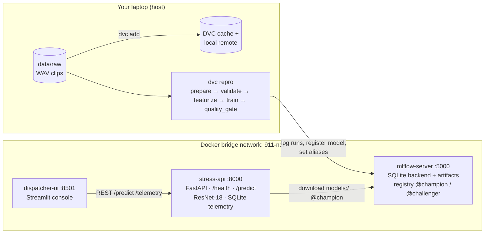

# 911 Under-Threat Voice Stress Detection System

A single-machine MLOps reference implementation. It scores short windows of emergency-call
audio for acoustic stress and highlights sustained high-stress segments on a dispatcher console.

> **Scope.** This is a decision-support prototype for a university demonstration. The bundled
> dataset is **synthetic** (parametric voice synthesis, see `src/synthetic.py`), so a model
> trained on it says nothing about real callers. A high score means "this window resembles the
> stressed training class", never "this caller is in danger". The dispatcher always decides.

---

## 1. Architecture



Per call: WAV upload → **data contract** (16 kHz, mono, WAV, ≥ 2 s) → **2.0 s windows with
0.5 s hop** → **Log-Mel (64×201) + MFCC (20×201)** → **ResNet-18** → P(stressed) per window →
**alert rule**: at least 3 *consecutive* windows with score **θ > 0.82** → asynchronous
**SQLite audit** → dispatcher console shows the segment in **red**.

| Concern | Tool | Where |
|---|---|---|
| Package management | uv, Python 3.11 | `pyproject.toml`, `.python-version` |
| Data and feature versioning | DVC, local remote | `dvc.yaml`, `data/raw.dvc`, `dvc.lock` |
| Data contracts | SHA-256 leakage, format, class floors | `src/data_contracts.py` |
| Features | librosa Log-Mel + MFCC | `src/preprocessing.py` |
| Model | ResNet-18 (2-D Log-Mel / 1-D MFCC) | `src/model.py` |
| Experiments and registry | MLflow (SQLite backend), aliases | `src/train.py`, `src/registry.py` |
| Promotion gate | champion vs challenger, behavioural tests, human approval | `src/quality_gate.py`, `src/behavioural.py` |
| Online evaluation (Course 4) | shadow, canary, A/B test, bandits | `src/rollout.py`, `src/bandits.py` |
| Serving | FastAPI with readiness probes | `src/serve.py` |
| Telemetry and audit | async SQLite (aiosqlite) | `src/telemetry.py` |
| Operator UI | Streamlit | `src/ui.py` |
| Orchestration | Docker Compose, `911-net` | `Dockerfile`, `docker-compose.yml` |
| CI | GitHub Actions with FakeModel | `.github/workflows/ci.yml` |

## 2. Repository layout

```
911-stress-detection/
├── .github/workflows/ci.yml     # CI: lint → contracts → tests → smoke → images; CD: push SHA tag → approval
├── Dockerfile                   # multi-stage: targets api | ui | mlflow
├── docker-compose.yml           # stress-api, mlflow-server, dispatcher-ui on 911-net
├── dvc.yaml                     # reproducible pipeline definition
├── params.yaml                  # every tunable number (θ, gate rules, canary steps, A/B, bandit…)
├── pyproject.toml               # uv project; extras: ml, api, tracking, ui; dev group
├── .env.example                 # compose overrides (MODEL_SOURCE, delays, ports, image tags)
├── scripts/
│   ├── generate_synthetic_data.py  # corpus → data/raw/{calm,stressed}; --channel phone = data shift
│   ├── make_demo_calls.py          # 5 demo calls → data/demo
│   ├── simulate_traffic.py         # labelled calls + dispatcher feedback (Course 4 demos)
│   ├── make_broken_challenger.py   # sabotaged @challenger → automatic canary rollback demo
│   ├── convert_audio.py            # any recording → 16 kHz mono WAV
│   └── smoke_test.py               # post-deploy probe + /predict check
├── src/
│   ├── config.py  preprocessing.py  synthetic.py  data_contracts.py  features.py
│   ├── model.py   fake_model.py     train.py      quality_gate.py     registry.py
│   ├── behavioural.py               # Course 7: min-functionality / invariance / slice tests
│   ├── rollout.py  bandits.py       # Course 4: shadow, canary, A/B statistics, bandit policies
│   ├── mlflow_model.py  alerting.py  telemetry.py  serve.py  ui.py
└── tests/
    ├── conftest.py               # WAV factory + FakeModel API client
    ├── test_preprocessing.py     # contract, windowing, feature shapes
    ├── test_data_contracts.py    # SHA-256 leakage, format, integrity, class floors
    ├── test_alerting.py          # θ / consecutive-window rule
    ├── test_model.py             # ResNet-18 adaptations, checkpoint round-trip
    ├── test_api.py               # 503→200 probes, /predict schema, 422s, audit log
    ├── test_rollout.py           # canary/A-B statistics vs the Course 4 worked examples
    ├── test_bandits.py           # ε-greedy, UCB1, Thompson, regret vs A/B
    ├── test_api_rollout.py       # shadow, canary rollback, A/B, bandit through the API
    ├── test_behavioural.py       # behavioural tests with FakeModels
    └── test_pipeline_smoke.py    # (slow) whole pipeline offline, 1 epoch
```

---

## 3. Step-by-step local execution guide

The commands work in the **VS Code terminal** on Windows (PowerShell), macOS and Linux unless
marked. Each step ends with **Why**, which ties it to an MLOps principle you can use in the
presentation.

### Step 0: Install the tools (one time)

1. **Docker Desktop**: <https://www.docker.com/products/docker-desktop/>. On Windows, accept the
   WSL 2 backend. Start it and wait until the whale icon says *Engine running*.
2. **VS Code**: <https://code.visualstudio.com/>, plus the *Python* and *Docker* extensions.
3. **Git**: <https://git-scm.com/downloads>.
4. **uv**: in a terminal:
   - Windows (PowerShell): `powershell -ExecutionPolicy ByPass -c "irm https://astral.sh/uv/install.ps1 | iex"`
   - macOS / Linux: `curl -LsSf https://astral.sh/uv/install.sh | sh`

   **Close and reopen VS Code** afterwards so the terminal picks up `uv`. Check with `uv --version`, `git --version` and `docker --version`.
5. Tell Git who you are, once per machine:
   `git config --global user.name "Your Name"` and
   `git config --global user.email "you@example.com"`.

**Why:** you need a small, explicit toolchain: one container runtime, one package manager and
one VCS. That makes "works on my machine" reproducible on any other machine.

### Step 1: Open the project

Unzip, then in VS Code use **File → Open Folder… → `911-stress-detection`**. Open a terminal
with **Terminal → New Terminal**. All commands below run from this folder.

### Step 2: Create the Python environment

```bash
uv sync --all-extras
```

uv downloads Python 3.11 if needed, creates `.venv/` and installs every dependency. PyTorch comes
from the **CPU-only** index, so there's no 2.5 GB CUDA download. Then in VS Code press
`Ctrl/Cmd+Shift+P`, choose **Python: Select Interpreter**, and pick `.venv`.

**Why:** the environment is *declared* in `pyproject.toml` and isolated per project. `uv sync`
also writes **`uv.lock`**, which pins exact versions. Commit it so CI, Docker and your teammates
resolve identical packages.

### Step 3: Run the fast test suite

```bash
uv run pytest -m "not slow"
```

You should see about 51 tests pass in a few seconds.

**Why:** this is the base of the **ML test pyramid**. `FakeModel` (`src/fake_model.py`) replaces the
11 M-parameter network, so the API contract, the 503/200 probes, the alert rule, the data
contracts and SQLite auditing are all verified without a GPU or any weights. That's why CI is fast.

### Step 4: Put the project under Git and DVC

```bash
git init
uv run dvc init
uv run dvc remote add -d localstore ../911-dvc-storage
git add .
git commit -m "Project scaffold"
```

**Why:** Git versions **code**. DVC versions **data and models** by storing content hashes in
small `.dvc`/`dvc.lock` files that Git tracks, while the heavy files go to the DVC cache and
remote (here a folder next to the project; in industry, S3 or GCS).

### Step 5: Create and version the dataset

```bash
uv run python -m scripts.generate_synthetic_data
uv run dvc add data/raw
git add data/raw.dvc data/.gitignore
git commit -m "Dataset v1: 160 synthetic clips"
uv run dvc push
```

**Why:** `dvc add` snapshots the exact bytes of the dataset (`data/raw.dvc` holds its md5).
Any later model can be traced back to this dataset version, and `dvc checkout` restores it.
That's **data lineage**.

> **Using real audio instead:** put 16 kHz mono WAVs in `data/raw/calm/` and
> `data/raw/stressed/` (use `scripts/convert_audio.py` to convert), then run `dvc add` again.

### Step 6: Start the MLflow tracking server (first container)

Make sure Docker Desktop is running, then:

```bash
docker compose up -d --build mlflow-server
docker compose ps
```

Wait until `mlflow-server` shows **(healthy)**, then open <http://localhost:5000>.

**Why:** experiment tracking is a **shared service**, not a local folder. The container keeps
its SQLite backend and model artifacts in the **named volume** `mlflow-data`, so they survive
`docker compose down` and container rebuilds. Its port is bound to `127.0.0.1` only.

### Step 7: Run the reproducible pipeline

```bash
uv run dvc dag
uv run dvc repro
```

`dvc repro` runs the five stages in `dvc.yaml`:

| Stage | What happens | MLOps principle |
|---|---|---|
| `prepare` | SHA-256 per clip, stratified split. Duplicates are grouped *before* splitting. | Leakage prevention by construction |
| `validate` | 16 kHz/mono/WAV format, hash integrity, **cross-split SHA-256 leakage**, class-ratio floor ≥ 30 %. A non-zero exit **stops the pipeline**. | Data contracts as gates |
| `featurize` | 2 s / 0.5 s windows → Log-Mel + MFCC tensors | Same code online and offline, so no training/serving skew |
| `train` | ResNet-18, about 1–2 min on CPU. Params, curves, git commit and DVC data hash go to MLflow. The model is registered with alias **@challenger**. | Experiment tracking, lineage |
| `quality_gate` | Challenger vs champion on the **same** test split: accuracy ≥ champion + 0.015, stressed recall ≥ 0.92, p95 latency ≤ 150 ms, and behavioural tests (functionality, invariance, slice floors). The first model is promoted automatically (bootstrap); later ones wait for human approval. | Automated, rule-based promotion |

Then inspect the results:

```bash
uv run dvc metrics show reports/quality_gate.json
git add dvc.lock reports
git commit -m "Pipeline run: champion v1"
uv run dvc push
```

In the MLflow UI, open **Experiments → voice-stress-911** to see the curves, and **Models →
voice-stress-detector** to see version 1 with aliases `@challenger` and `@champion`.

**Why:** `dvc.lock` records the hash of every input and output. Run `uv run dvc repro` again and
everything is skipped ("Data and pipelines are up to date"). Change one value in `params.yaml`
and **only the affected stages** re-run. That's reproducibility plus incremental computation.

> If `train` fails with *Connection refused*, MLflow isn't up yet (Step 6). If you changed
> `MLFLOW_HOST_PORT`, first set `MLFLOW_TRACKING_URI` to match. In PowerShell:
> `$env:MLFLOW_TRACKING_URI="http://localhost:5001"`.

### Step 8: Create the demo calls

```bash
uv run python -m scripts.make_demo_calls
```

This produces `data/demo/` with four calls:

- **call_01**: calm. Expect green.
- **call_02**: calm, then duress, then calm. Expect a **red alert**.
- **call_03**: a short burst. Expect amber windows but **no alert**, because of the consecutive rule.
- **call_04**: 44.1 kHz stereo. Expect **HTTP 422**, a contract violation.

### Step 9: Start the whole stack

```bash
docker compose up -d --build
docker compose ps
```

The first build takes about 5–10 min while it downloads PyTorch CPU. Later builds reuse cached
layers. Watch the readiness probe while the model loads:

```bash
# Windows PowerShell: use curl.exe (plain "curl" is an alias for Invoke-WebRequest)
curl.exe -i http://localhost:8000/health      # HTTP 503 {"status":"loading"} … then HTTP 200
docker compose logs -f stress-api              # Ctrl+C to stop following
```

**Why:**

- **Container isolation.** Three images, each with only its own dependencies. The UI image has
  no PyTorch, so a UI change never rebuilds the ML layer.
- **Service discovery.** On `911-net`, containers reach each other by name
  (`http://stress-api:8000`, `http://mlflow-server:5000`), not by IP.
- **Readiness probes.** `/health` returns **503** while weights load (plus a JIT warm-up), then
  **200**. Docker's healthcheck gives a **30 s startup budget** (`start_period`). `dispatcher-ui`
  has `depends_on: condition: service_healthy`, so it **never starts against a half-loaded
  model**, and `/predict` itself refuses traffic with 503 and `Retry-After` until ready.
- **Volume mounting.** `./models` is mounted **read-only**, giving an offline fallback
  checkpoint. `./params.yaml` is read-only, so you can tune θ without a rebuild. The SQLite audit
  log lives in the named volume `telemetry-data`, so it survives restarts.

### Step 10: Smoke-test the deployment

```bash
uv run python -m scripts.smoke_test
```

It prints the 503 → 200 transition and then the verdict for each demo call.

**Why:** a **post-deployment smoke test** checks the *running system* (network, volumes, model
load), which unit tests can't.

### Step 11: Use the dispatcher console

Open <http://localhost:8501>.

1. The sidebar shows **API READY** with the model version, for example `voice-stress-detector@champion v1`.
2. Pick **call_02_under_duress.wav** and click **Analyze call**. With *Simulate live stream* on,
   the windows appear one hop at a time, and the **red PRIORITY ALERT** banner appears once three
   consecutive windows exceed θ = 0.82. Alert windows are red in the chart and the table.
3. Try **call_03** (amber, no alert) and **call_04** (data-contract rejection).
4. The **Audit log** tab shows every call read back from SQLite, with alert calls in red.

The interactive API docs are at <http://localhost:8000/docs>.

### Step 12: Champion vs challenger, human approval and rollback

The full Course 4 / Course 7 scenario (data shift → retraining → shadow → canary → A/B →
bandit → approval → rollback) is in **section 3b** below. The core idea in three commands:

```bash
uv run dvc repro                                  # new version -> @challenger, gate decides
uv run python -m src.quality_gate --promote-challenger   # a human approves
uv run python -m src.quality_gate --rollback             # undo in one command
```

With `auto_promote: false`, a passing challenger is tagged `awaiting_approval` in MLflow and is
**not** promoted on its own. The only exception is the very first model, when there is no
champion to protect (bootstrap). The API checks the aliases every 15 s and hot-swaps models
without dropping traffic. You can also click **⬆️ Hot-reload models** in the console.

**Why:** models are promoted by **moving an alias** in the registry, never by copying files by
hand. Every version keeps its run, parameters, data hash and gate report. Rollback means
pointing `@champion` back at the previous version.

### Step 13: Demonstrate the readiness probe on stage

```bash
# in .env (copy .env.example first): MODEL_LOAD_DELAY_SECONDS=15
docker compose up -d stress-api
curl.exe -i http://localhost:8000/health     # 503 for ~15 s, then 200
```

### Step 14: CI on GitHub

Create an empty GitHub repository, then:

```bash
git remote add origin https://github.com/<you>/911-stress-detection.git
git branch -M main
git push -u origin main
```

Open the **Actions** tab. The pipeline runs these jobs:

1. **lint**: ruff
2. **data-contracts**: generates a fresh small dataset and validates it
3. **test**: pytest with FakeModel
4. **model-smoke**: the whole pipeline with a 1-epoch model
5. **docker**: builds all three images, boots the stack with `MODEL_SOURCE=fake`, and probes
   `/health` across `911-net`

**Why:** **continuous integration.** Every push is linted, contract-checked and tested before
an image is built, and only tested code becomes a container. Large data never goes to GitHub:
DVC keeps it in the local remote, and CI generates its own small synthetic set.

### Step 15: Shut down

```bash
docker compose down        # stop containers, keep volumes (MLflow runs, audit log)
docker compose down -v     # also delete volumes (clean slate)
```

### Optional: demo the UI before training anything

```bash
# PowerShell
$env:MODEL_SOURCE="fake"; $env:FAKE_SCORES="0.1,0.2,0.9,0.95,0.97,0.93,0.2"; docker compose up -d --build
# macOS / Linux
MODEL_SOURCE=fake FAKE_SCORES="0.1,0.2,0.9,0.95,0.97,0.93,0.2" docker compose up -d --build
```

The scores are canned test-double values, not predictions. Afterwards, in PowerShell run
`Remove-Item Env:MODEL_SOURCE, Env:FAKE_SCORES`, or open a new terminal, before starting the
real stack.

---

## 3b. Release engineering (Course 4) and CI/CD (Course 7)

**The scenario.** The production model (v1) was trained on clean recordings. New calls start
arriving over noisy, narrow-band mobile lines (a *distribution shift*). The behavioural slice
tests show that v1 now fails on one slice (female voices on phone lines). Continuous training
produces v2 on the new data. The offline gate passes v2, but it is **not** promoted
automatically: it must first earn trust on live traffic.

```bash
# continuous training (new data -> new challenger)
uv run python -m scripts.generate_synthetic_data --channel phone
uv run dvc add data/raw
uv run dvc repro                 # v2 registered as @challenger, gate PASS, "awaiting_approval"

# the API picks up @challenger within 15 s; open the console's Release tab
uv run python -m scripts.simulate_traffic --calls 200                     # shadow
uv run python -m scripts.simulate_traffic --calls 600 --until-decision    # canary
uv run python -m scripts.make_broken_challenger                           # rollback demo
uv run python -m scripts.make_broken_challenger --restore
uv run python -m scripts.simulate_traffic --calls 1000 --until-decision   # A/B test
uv run python -m scripts.simulate_traffic --calls 300                     # bandit

# continuous delivery: a human approves, rollback is one command
uv run python -m src.quality_gate --promote-challenger
uv run python -m src.quality_gate --rollback
```

| Course concept | Where it lives |
|---|---|
| Shadow deployment | `rollout.mode: shadow`. The challenger scores every call in a background task; dispatchers never see it |
| Canary: steps, sticky routing, guardrails, automatic rollback | `src/rollout.py::canary_decision`, evaluated after every call |
| One-sided pooled z-test, p95 latency ratio, PSI / KS, class collapse | `src/rollout.py` |
| A/B test: pre-computed sample size, no peeking, unpooled CI, SRM | `src/rollout.py::ab_report` |
| Bandits: ε-greedy, UCB1, Thompson, traffic floor, logged propensities, regret | `src/bandits.py` |
| Delayed reward | `POST /feedback` (console buttons or the simulator) |
| Fallback pattern | a failing challenger falls back to the champion and is counted as an error |
| Behavioural model tests and gate report with standard error | `src/behavioural.py`, `src/quality_gate.py` |
| Continuous delivery with human approval | `auto_promote: false`, `--promote-challenger`, `release` job in the `production` environment |
| Build once, tag with the commit SHA | `images` job: build → boot → probe → push the same images to GHCR |
| Two release trains | code = image tag; model = MLflow alias, followed live by the API (`MODEL_POLL_SECONDS`) |
| Rollback in one command | `--rollback` moves `@champion` back to the previous version |

> In a 911 setting, A/B tests and bandits deliberately send some real calls to the worse
> model. They are demonstrated here **on simulated traffic only**. The real release path is
> shadow → canary → human approval.

## 4. Troubleshooting

| Symptom | Fix |
|---|---|
| `uv` / `git` not recognized | Reopen VS Code (PATH refresh). On Windows, also try a new PowerShell window. |
| `Cannot connect to the Docker daemon` | Start Docker Desktop and wait for *Engine running*. |
| macOS: port 5000 already in use | Turn off *AirPlay Receiver* (System Settings → General → AirDrop & Handoff), or set `MLFLOW_HOST_PORT=5001` in `.env` and export `MLFLOW_TRACKING_URI=http://localhost:5001`. |
| `stress-api` stays *unhealthy*, `/health` shows `"status":"failed"` | No champion exists yet. Run Steps 6–7 first, or use `MODEL_SOURCE=fake`. Then `docker compose up -d stress-api`. |
| `dispatcher-ui` never starts | It waits for `stress-api` to be healthy, so fix that first. Check `docker compose logs stress-api`. |
| Docker build runs out of memory (Windows) | Docker Desktop → Settings → Resources: give WSL 2 at least 4 GB. |
| `dvc repro` says *data/raw does not exist* | Run Step 5. After a fresh clone, use `uv run dvc pull` instead. |
| Your own recording returns 422 | `uv run python -m scripts.convert_audio in.m4a data/demo/mine.wav` (MP3/M4A need FFmpeg). |
| Release tab says "no @challenger model loaded" | `@challenger` must point to a different version than `@champion`. Train one (`dvc repro` with new data), then wait 15 s or click *Hot-reload models*. |
| CI `test` job fails at `uv sync --locked` | `uv.lock` is missing or stale. Run `uv lock`, then commit and push `uv.lock`. |
| `release` job never asks for approval | GitHub → Settings → Environments → **production** → add yourself under *Required reviewers*. On a private repo, this needs a paid plan. |
| Intel Mac: torch fails to install | PyTorch no longer ships Intel-Mac wheels. Run the stack in Docker (Step 9) and train on another machine. |

## 5. Configuration reference

All numbers live in `params.yaml`. The serving container also reads these environment variables:
`MODEL_SOURCE` (`auto|mlflow|file|fake`), `MODEL_LOAD_DELAY_SECONDS`, `FAKE_SCORES`,
`DURESS_THRESHOLD`, `CONSECUTIVE_WINDOWS`, `MODEL_NAME`, `MODEL_ALIAS`, `TELEMETRY_DB`.

## 6. Limitations (say these in the presentation)

- The synthetic data encodes textbook stress correlates (raised F0, 8–12 Hz tremor, jitter,
  faster syllables). Near-perfect test accuracy here is **not** evidence of real-world performance.
- θ = 0.82 and K = 3 are configurable demo values, not calibrated clinical thresholds.
- The 1.5-point margin is a project rule, not a significance test. Real promotion would also look
  at calibration, subgroup performance, false-alarm cost and independent validation, with human
  sign-off.
- Docker Compose on one host gives isolation and health-gated startup, but not multi-node
  failover or a zero-downtime guarantee.
