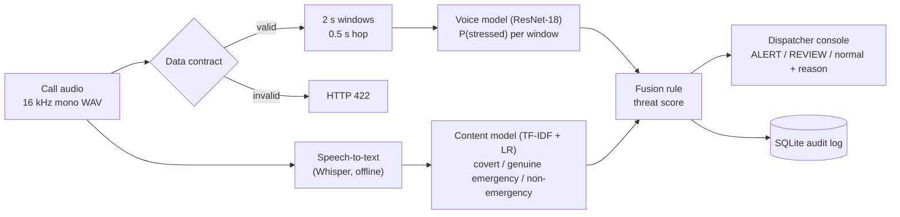
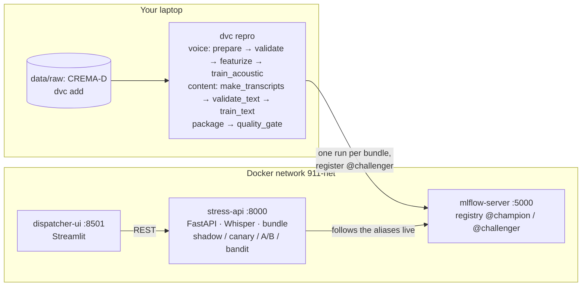

# 911 Under-Threat (Covert Call) Detection System

A single-machine MLOps system that helps an emergency dispatcher spot **callers who are
under threat but cannot say so**, such as someone "ordering a pizza" on 911 while an
attacker listens.

> **The core idea.** On a 911 line, stress is *normal*: "someone is dead in front of me"
> should sound terrified, and must **not** raise a threat alert. The warning sign is a
> **mismatch**: content that does not belong on an emergency line ("a large pizza with
> pepperoni") or that plays along with the dispatcher's coded questions ("yes, with
> pepperoni"), sometimes combined with tension in the voice. The system therefore
> combines **what is said** (speech-to-text + a transcript classifier) with **how it is
> said** (a voice-stress model) and explains every flag to the dispatcher.
>
> **Scope.** This is a decision-support prototype for a university project. The voice
> model is trained on **real acted speech** (CREMA-D: neutral vs fear), and the content
> model on **authored call scripts** (no public dataset of real covert 911 calls exists).
> A flag means "worth a closer look", never "proof of a threat". The dispatcher decides.

---

## 1. How a call is analysed



**Fusion rule** (`src/fusion.py`, parameters in `params.yaml → fusion`):

```
threat = p_covert × (0.85 + 0.25 × stress)  +  0.40 × p_non_emergency × stress
ALERT if threat ≥ 0.50  ·  REVIEW if threat ≥ 0.30
```

| Situation | Result |
|---|---|
| Genuine emergency + terrified voice | **normal**: stress is expected (p_covert ≈ 0) |
| Covert-looking content + calm voice | **ALERT**: content carries most of the weight |
| Covert-looking content + tense voice | **ALERT**, higher score |
| Harmless question + terrified voice | **REVIEW**: content and voice do not match |
| No transcript available | **normal**, voice stress shown for information only |

The weights were chosen on the **validation** scenario families, never on the test set.

## 2. The MLOps system



| Concern | Tool | Where |
|---|---|---|
| Packages | uv, Python 3.11 | `pyproject.toml` |
| Data versioning | DVC (local remote) | `dvc.yaml`, `data/raw.dvc`, `dvc.lock` |
| Audio data contracts | format, SHA-256 leakage, **speaker leakage**, class floors | `src/data_contracts.py` |
| Text data contracts | schema, **scenario-family leakage**, duplicate leakage, coverage | `src/text_contracts.py` |
| Voice model | ResNet-18 on Log-Mel spectrograms | `src/model.py`, `src/train.py` |
| Content model | explainable TF-IDF + logistic regression, exported to JSON | `src/text_model.py` |
| Speech-to-text | faster-whisper `base.en`, baked into the API image | `src/asr.py`, `Dockerfile` |
| Fusion + bundle | one registered unit: voice + content + rule | `src/fusion.py`, `src/bundle.py`, `src/package.py` |
| Experiment tracking, registry | MLflow (SQLite backend), aliases | `src/package.py`, `src/registry.py` |
| Quality gate | covert recall, genuine-emergency false alarms, behavioural tests | `src/quality_gate.py`, `src/behavioural.py` |
| Online evaluation (Course 4) | shadow, canary, A/B, bandits | `src/rollout.py`, `src/bandits.py` |
| Serving | FastAPI with readiness probes | `src/serve.py` |
| Console | Streamlit | `src/ui.py` |
| Orchestration | Docker Compose on `911-net` | `docker-compose.yml` |
| CI/CD (Course 7) | GitHub Actions: tests → images tagged with the commit → approval | `.github/workflows/ci.yml` |

## 3. Data, and why the numbers are believable

| | Voice model | Content model |
|---|---|---|
| Data | **CREMA-D** (Cao et al. 2014; ODbL licence): 91 actors, neutral (1,087) vs fear (1,271) clips | 1,920 authored caller transcripts in 32 scenario families, 3 classes |
| Split | **by speaker**: 64 train / 9 val / 18 test actors | **by scenario family**: test families are unseen phrasings |
| Test accuracy | ≈ 86% on unseen speakers | ≈ 96% on unseen families |
| Simple baseline | linear model on the average spectrum ≈ 68% | keyword rule ("pizza/order ⇒ threat") ≈ 85%, but only **49% covert recall** |
| Shuffled-label control | ≈ 52% (chance) | ≈ 32% (chance = 33%) |

`uv run python -m scripts.sanity_report` reproduces this table (`reports/sanity_report.json`).
The content data contains deliberate **traps**: "my son is choking on *pizza*"
(genuine emergency) and "sorry, wrong number, I wanted the *pizza* place" (no threat),
so a keyword rule fails the behavioural tests.

**Lesson learned (worth a slide).** The first prototype used synthetic tones whose
calm and stressed parameter ranges did not overlap, and scored about 99%. The
shuffled-label control showed no leakage, but a plain linear model reached 91%: the task
was too easy. Replacing the data with real speakers, and adding baselines and controls to
every run, is what makes today's numbers meaningful.

## 4. Fresh setup (for a new machine or a reviewer)

You need Docker Desktop, VS Code, Git and uv
(`powershell -ExecutionPolicy ByPass -c "irm https://astral.sh/uv/install.ps1 | iex"`).

```bash
uv sync --all-extras                       # Python 3.11 env + CPU PyTorch + Whisper
uv run pytest -m "not slow"                # ~110 fast tests, no GPU, no model weights
git init && uv run dvc init
uv run dvc remote add -d localstore ../911-dvc-storage
uv run python -m scripts.download_cremad   # ~2,350 real clips, ~185 MB, 5-15 min
uv run dvc add data/raw
docker compose up -d --build mlflow-server
uv run dvc repro                           # both models, bundle v1, gate (~15 min on CPU)
uv run python -m scripts.sanity_report
uv run python -m scripts.make_demo_calls
docker compose up -d --build               # first build downloads Whisper into the image
uv run python -m scripts.smoke_test
```

Open the console at http://localhost:8501, MLflow at http://localhost:5000 and the API
docs at http://localhost:8000/docs. The first bundle is promoted automatically
(bootstrap); every later one waits for human approval.

## 5. Release engineering (Course 4) and CI/CD (Course 7)

**Scenario.** New calls arrive over noisy mobile phone lines (a distribution shift).
The gate's slice tests already warned that the clean-trained voice model fails on
phone-line audio. Continuous training creates bundle v2 from phone-augmented data. It
passes the offline gate, but is **not** promoted automatically: it must earn trust on
live traffic first.

```bash
uv run python -m scripts.augment_phone        # new data: phone-line versions of every clip
uv run dvc add data/raw && uv run dvc repro   # v2 -> @challenger, "awaiting_approval"

uv run python -m scripts.simulate_traffic --channel phone --calls 200            # shadow
uv run python -m scripts.simulate_traffic --channel phone --calls 600 --until-decision  # canary
uv run python -m scripts.make_broken_challenger          # sabotaged model -> auto rollback
uv run python -m scripts.make_broken_challenger --restore
uv run python -m scripts.simulate_traffic --channel phone --calls 1000 --until-decision # A/B
uv run python -m scripts.simulate_traffic --channel phone --calls 300            # bandit

uv run python -m src.quality_gate --promote-challenger   # human approval
uv run python -m src.quality_gate --rollback             # one-command rollback
```

The experiment mode is chosen in the console's **Release** tab.

| Course concept | Where it lives |
|---|---|
| Shadow deployment | the challenger scores every call in the background; nobody sees it |
| Canary: sticky routing, steps 10→25→50→100%, guardrails, automatic rollback | `src/rollout.py::canary_decision` |
| One-sided pooled z-test, p95 latency ratio, PSI / KS, class collapse | `src/rollout.py` |
| A/B test: sample size fixed in advance, no peeking, unpooled CI, SRM check | `src/rollout.py::ab_report` |
| Bandits: ε-greedy, UCB1, Thompson, 5% floor, logged propensities, regret | `src/bandits.py` |
| Delayed reward | `POST /feedback` (console buttons or the simulator) |
| Behavioural tests, standard error in the gate report | `src/behavioural.py`, `src/quality_gate.py` |
| Continuous delivery + human approval | `auto_promote: false`, `--promote-challenger`, `release` job (GitHub environment `production`) |
| Build once, tag with the commit SHA | CI `images` job pushes the tested images to GHCR |
| Two release trains | code + Whisper = image tag; voice + content models = MLflow alias |

> In a 911 setting, A/B tests and bandits deliberately send some real calls to the weaker
> model. They are demonstrated on **simulated traffic only**. The real release path is
> shadow → canary → human approval.

## 6. Repository layout

```
├── .github/workflows/ci.yml        lint → data contracts (real CREMA-D slice) → tests → smoke → images → approval
├── Dockerfile / docker-compose.yml api (bundle + Whisper baked in) · ui · mlflow, on 911-net
├── dvc.yaml / params.yaml          pipeline + every tunable number (fusion, gate, canary, A/B, bandit)
├── docs/demo_call_scripts.md       7 scripts to record yourself for a realistic demo
├── scripts/
│   ├── download_cremad.py          real voices (neutral vs fear) + speaker demographics
│   ├── augment_phone.py            phone-line copies (data-shift scenario)
│   ├── sanity_report.py            shuffled-label controls + simple baselines
│   ├── make_demo_calls.py          demo calls from held-out real speakers
│   ├── simulate_traffic.py         held-out transcripts + held-out voices + feedback
│   ├── make_broken_challenger.py   canary rollback demo
│   ├── convert_audio.py            phone recordings (m4a/mp3) → 16 kHz mono WAV
│   ├── smoke_test.py               post-deploy check
│   └── generate_synthetic_data.py  CI test fixtures only (not training data)
├── src/  asr · augment · bandits · behavioural · bundle · config · data_contracts · features
│         fake_model · fusion · mlflow_model · model · package · preprocessing · quality_gate
│         registry · rollout · serve · telemetry · text_contracts · text_model · train
│         transcripts · ui
└── tests/  preprocessing · data_contracts · content · bundle · alerting · model · api
            api_rollout · rollout · bandits · behavioural · pipeline_smoke (slow)
```

## 7. Troubleshooting

| Symptom | Fix |
|---|---|
| `stress-api` unhealthy, `/health` says "bundle not found" or "acoustic-only" | No bundle champion yet: run `uv run dvc repro`, then `docker compose up -d stress-api`. |
| `/health` shows `"asr": "failed ..."` | The Whisper weights could not be loaded. Rebuild with internet access: `docker compose build --no-cache stress-api`. Typed transcripts still work. |
| `download_cremad` stops with "could not download" | Network hiccup: run it again; already-downloaded files are skipped. |
| CI `test` job fails at `uv sync --locked` | `uv.lock` is stale: run `uv sync --all-extras`, then commit `uv.lock`. |
| Console Release tab: "no @challenger model loaded" | `@challenger` must differ from `@champion`: train one (`dvc repro` with new data), wait 15 s. |
| `release` job never asks for approval | GitHub → Settings → Environments → **production** → *Required reviewers*. |
| Your own recording: transcript is empty or wrong | Speak clearly in English, 20 cm from the phone; convert with `scripts.convert_audio`. |
| macOS: port 5000 busy | Disable AirPlay Receiver, or set `MLFLOW_HOST_PORT=5001` in `.env` and export `MLFLOW_TRACKING_URI`. |

## 8. Limitations (say these in the presentation)

- **Content data is authored**, not real 911 calls. Real covert calls are rarer, messier
  and more varied. The content model would need real, consented, labelled call data.
- **Voice data is acted** (CREMA-D actors performing fear), which is a proxy for real
  duress.
- **The stress profile used to pair transcripts with voices** in the gate and simulator is
  an assumption (`params.yaml → quality_gate.stress_profile`).
- **The fusion rule is hand-designed and transparent** rather than learned, because no
  dataset links call outcomes to both audio and transcript. With such data, it would
  become a calibrated model.
- **English only.** Whisper supports Arabic, but the content model would need Arabic scripts.
- **Per-call analysis** with a replay view, not word-by-word live streaming.
- Docker Compose on one laptop gives isolation and health-gated startup, but not
  multi-node failover.
